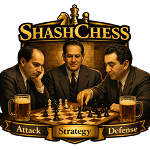

# Introduction



ShashChess is a free UCI chess engine derived from Stockfish family chess engines.
For the evaluation function, we utilize the collaboration between Leela Chess Zero and Stockfish, for which we express our sincere gratitude.
The goal is to apply Alexander Shashin theory exposed on the following book :
https://www.amazon.com/Best-Play-Method-Discovering-Strongest/dp/1936277468
to improve

- base engine strength
- engine's behaviour on the different positions types (requiring the corresponding algorithm) :
    - Tal
    - Capablanca
    - Petrosian
    - the mixed ones
       * Tal-Capablanca
       * Capablanca-Petrosian
       * Tal-Capablanca-Petrosian

Also during the search, to enhance it, we use both standard and Q/Self reinforcement learning.

## Terms of use

Shashchess is free, and distributed under the **GNU General Public License** (GPL). Essentially, this

means that you are free to do almost exactly what you want with the program, including distributing

it among your friends, making it available for download from your web site, selling it (either by

itself or as part of some bigger software package), or using it as the starting point for a software

project of your own.

The only real limitation is that whenever you distribute ShashChess in some way, you must always

include the full source code, or a pointer to where the source code can be found. If you make any

changes to the source code, these changes must also be made available under the GPL.

For full details, read the copy of the GPL found in the file named _Copying.txt_.

## Files

This distribution of ShashChessPro consists of the following files:

- Readme.md, the file you are currently reading.
- Copying.txt, a text file containing the GNU General Public License.
- src, a subdirectory containing the full source code, including a Makefile and the compilation
    scripts makeAll.bat (Windows) and makeAll.sh (Linux).

## Uci options

### Hash Memory

#### Hash

_Integer, Default: 16, Min: 1, Max: 131072 MB (64-bit) : 2048 MB (32-bit)_


The amount of memory to use for the hash during search, specified in MB (megabytes). This
number should be smaller than the amount of physical memory for your system.
A modern formula to determine it is the following:

_(T x S / 100) MB_
where
_T = the average move time (in seconds)
S = the average node speed of your hardware_
A traditional formula is the following:
_(N x F x T) / 512_
where
_N = logical threads number
F = clock single processor frequency (MB)
T = the average move time (in seconds)_

#### Clear Hash

Button to clear the Hash Memory.
If the Never Clear Hash option is enabled, this button doesn't do anything.

### Threads

_Integer, Default: 1, Min: 1, Max: 512_
The number of threads to use during the search. This number should be set to the number of cores
(physical+logical) in your CPU.

### Ponder (checkbox)

_Boolean, Default: True_
Also called "Permanent Brain" : whether or not the engine should analyze when it is the opponent's
turn.


Usually not on the configuration window.

### MultiPV

_Integer, Default: 1, Min: 1, Max: 500_
The number of alternate lines of analysis to display. Specify 1 to just get the best line. Asking for
more lines slows down the search.
Usually not on the configuration window.

### UCI_Chess960 (checkbox)

Whether or not ShashChess should play using Chess 960 mode. Usually not on the configuration
window.

### Move overhead 

_Default 30, min 0, max 5000_
In ms, the default value seems to be the best on Linux systems, but must be increased for slow GUI like Fritz. In general, on Windows system it seems a good value to be 100.

### Slow mover

_Default 84, min 10, max 1000_
 "Time usage percent": how much the engine thinks on a move. Many engines seem to move faster and the engine is behind in time clock. With lower values it plays faster, with higher values slower - of course always within the time control.

### Sygyzy End Game table bases

Download at [http://olympuschess.com/egtb/sbases](http://olympuschess.com/egtb/sbases) (by Ronald De Man)

#### SyzygyPath

The path to the Syzygy endgame tablebases.this defines an absolute path on your computer to the
tablebase files, also on multiple paths separated with a semicolon (;) character (Windows), the colon
(:) character (OS X and Windows) character.
The folder(s) containing the Syzygy EGTB files. If multiple folders are used, separate them by the ;
(semicolon) character.

#### SygyzyProbeDepth

_Integer, Default: 1, Min: 1, Max: 100_
The probing tablebases depth (always the root position).
If you don't have a SSD HD,you have to set it to maximize the depth and kn/s in infinite analysis
and during a time equals to the double of that corresponding to half RAM size.
Choice a test position with a few pieces on the board (from 7 to 12). For example:

- Fen: _8/5r2/R7/8/1p5k/p3P3/4K3/8 w -- 0 1_ Solution : Ra4 (=)
- Fen: _1R6/7k/1P5p/5p2/3K2p1/1r3P1P/8 b - - 1 1_ Solution: 1...h5 !! (=)

#### Syzygy50MoveRule
    
Disable to let fifty-move rule draws detected by Syzygy tablebase probes count
as wins or losses. This is useful for ICCF correspondence games.
	
#### SygyzyProbeLimit

_Integer, Default: 6, Min: 0, Max: 6_
How many pieces need to be on the board before ShashChess begins probing (even at the root).
Current default, obviously, is for 6-man.

### Advanced Chess Analyzer

Advanced analysis options, highly recommended for CC play

#### Full depth threads

_Integer, Default: 0, Min: 0, Max: 512_
The number of settled threads to use for a full depth brute force search. 
If the number is greater than threads number, all threads are for full depth brute force search.

### MonteCarlo Tree Search section (experimental: thanks to original Stephan Nicolet work)

#### MCTS by Shashin

_Boolean, Default: False_ If activated, thanks to Shashin theory, the engine will use the MonteCarlo Tree Search for Petrosian high, high middle and middle positions, in the manner specified by the following parameters. The idea is to exploit Lc0 best results in those positions types, because Lc0 uses mcts in the search.

#### MCTSThreads

_Integer, Default: 0, Min: 0, Max: 512_
The number of settled threads to use for MCTS search except the first (main) one always for alpha-beta search. 
In particular, if the number is greater than threads number, they will all do a montecarlo tree search, always except the first (main) for alpha-beta search.

#### MCTS Multi Strategy 

_Integer, Default: 20, Min: 0, Max: 100_ 
Only in multi mcts mode, for tree policy.

#### MCTS Multi MinVisits

_Integer, Default: 5, Min: 0, Max: 1000_
Only in multi mcts mode, for Upper Confidence Bound.

#### MCTS Explore

_Boolean, Default: False_ If activated, mcts is also performed for highly Tal type positions and Capablanca and Petrosian type positions.

### Live Book section (thanks to Eman's author Khalid Omar for windows builds)

#### LiveBook Proxy Url
_String, Default: "" (empty string)_  
The proxy URL to use for the live book. If empty, no proxy is used. The proxy should use the ChessDB REST API format.

#### LiveBook Proxy Diversity
_Boolean, Default: False_  
If enabled, the engine will play a random (best) move by the proxy (query and not querybest action).

#### LiveBook Lichess Token
_String, Default: "" (empty string)_  
Personal API token of a Lichess account. Since March 2026 the Lichess opening explorer (`explorer.lichess.org`) only answers authenticated requests, so this token is required by **LiveBook Lichess Games**, **LiveBook Lichess Masters** and **LiveBook Lichess Player**. Create it at https://lichess.org/account/oauth/token without selecting any scope: a token without scopes can only read public data. The Lichess Tablebase does not need it. If the token is missing or refused, the engine prints an `info string` and disables these live books until the LiveBook options are changed.

#### LiveBook Timeout
_Integer, Default: 5000, Min: 100, Max: 60000_  
Maximum duration in milliseconds of a live book or online tablebase request (the lookup is done on the engine's clock). With a clock (or `go movetime`) a request also never takes more than half of the optimum time for the move, and the live books are not queried if less than 100 ms would be left for the request, so that a slow server cannot make the engine lose on time. After a network or server error the live book is paused for 30 seconds, after a rate limit (HTTP 429) for 60 seconds.

#### LiveBook Lichess Games
_Boolean, Default: False_  
If enabled, the engine will use the Lichess live book by querying the Lichess API to access the game database available on the site. This option allows the engine to access a wide range of games played on Lichess to enhance its move choices. Requires **LiveBook Lichess Token**.  
Only the games of the players in the rating band of the engine are used. The engine Elo is **UCI_Elo** when **UCI_LimitStrength** is enabled, otherwise the engine maximum (3190):
- **Beginner** (up to 1999): Lichess players rated 1200-1999
- **Intermediate** (2000-2199): Lichess players rated 2000-2199
- **Advanced** (2200-2399): Lichess players rated 2200-2499 (Lichess has no 2400 group)
- **Expert** (2400-3190): Lichess players rated 2500 and more

#### LiveBook Lichess Masters
_Boolean, Default: False_  
If enabled, the engine will use the Lichess live book specifically for masters' games. This allows the engine to analyze games played at a high level and utilize the best moves made by master-level players. Requires **LiveBook Lichess Token**.

#### LiveBook Lichess Player
_String, Default: "" (empty string)_  
The Lichess player name to use for the live book. If left empty, the engine will not query for the specific player's game data. This option is useful for studying or adapting the engine to a particular player's style. Requires **LiveBook Lichess Token**.

#### LiveBook Lichess Player Color
_String, Default: "White"_  
Specifies the color the engine will play as in the Lichess live book for the specified player.
- **"White"**: The engine considers the games played by the specified player as White. When it's Black's turn, the move that performed best against the player will be chosen.
- **"Black"**: The engine considers the games played by the specified player as Black. When it's White's turn, the move that performed best against the player will be chosen.
- **"Both"**: The engine will always pretend to be the player, regardless of color, and choose the best-performing moves for the specified player.

#### LiveBook ChessDB
_Boolean, Default: False_  
If enabled, the engine will use the ChessDB live book by querying the ChessDB API.

#### LiveBook Depth
_Integer, Default: 255, Min: 1, Max: 255_  
Specifies the depth to reach using the live book in plies. The depth determines how many half-moves the engine will consider from the current position.

#### LiveBook Width
_Integer, Default: 1, Min: 1, Max: 20_  
The opening live books (Proxy, ChessDB, Lichess Player, Lichess Games, Lichess Masters) choose the move at random, with the same probability, among the best move and at most **LiveBook Width** - 1 moves equivalent to it, as **Book N Width** does for the CTG/BIN books. With 1 (default) the best move is always played. Equivalent moves:
- **ChessDB**: the moves ranked best (`!`, rank 2) by ChessDB, i.e. a few centipawns from the best one at most. The order is the ChessDB score.
- **Lichess Player, Games and Masters**: the moves whose success rate (wins + draws / 2 for the side to move, the win probability of the Shashin zones) is in the same Shashin zone as the best move and that, as for the BIN books, have been played in at least 0.5% of the games. The order is the number of wins, then of draws.
- **Proxy**: the proxy answers a single move (see **LiveBook Proxy Diversity**).

The online tablebases always play the best move. The live books, as the CTG/BIN books, are not used with `go infinite`, `go mate`, `go depth` and `go nodes`; they are used when pondering, so that on a ponderhit the book move is played at once.

#### ChessDB Tablebase
_Boolean, Default: False_  
If enabled, allows the engine to query the ChessDB API for Tablebase data, up to 7 pieces. This provides perfect endgame knowledge for positions with up to 7 pieces. The online tablebases are used only if the Syzygy tablebases cannot probe the position (missing files, **SyzygyProbeLimit** lower than the number of pieces, castling rights); with at most 7 pieces the opening live books are never used.

#### Lichess Tablebase
_Boolean, Default: False_  
If enabled, allows the engine to query the Lichess API for Tablebase data, up to 7 pieces. This option also provides perfect endgame knowledge for positions with up to 7 pieces. As for **ChessDB Tablebase**, it is used only if the Syzygy tablebases cannot probe the position.

#### ChessDB Contribute
_Boolean, Default: False_  
If enabled, allows the engine to store a move in the queue of ChessDb to be analyzed.

### Full depth threads

_Default 0, min 0, max 512_ The number of threads doing a full depth analysis (brute force). Useful in analysis of particular hard positions to limit the strong pruning's drawbacks. 

### Anti Dancing Analysis
_Boolean, Default: False_
Solves one of the most annoying issues when analyzing with modern chess engines: the tendency to "dance" with pieces (repeating the position once or twice) before executing the actual winning plan. Engines normally do this to push the search horizon further or to burn the opponent's clock in practical play, resulting in unnecessarily long, confusing, and unreadable Principal Variations (PVs).
When this option is set to True, ShashChess will strictly forbid any position repetition when it considers itself to be winning. The engine is forced to immediately discard repetitive maneuvers (scoring them as a draw) and must compute the most direct, linear, and human-readable path to convert the advantage.

Usage Recommendations:
Deep Analysis (ON): Highly recommended when analyzing games, studying openings, or trying to understand the core strategic plan of a position without useless tactical noise.
Match Play & Tournaments (OFF): Must be disabled during actual games or engine-vs-engine matches. In some specific scenarios (like pawn endgames), triangulating to lose a tempo via repetition is mathematically the only way to win. If enabled during a game, the engine might throw away a win to avoid the repetition penalty.

### Variety  (checkbox)

Default is Off: no variety. The other values are "Standard" (no elo loss: randomicity in Capablanca zone) and Psychological (randomicity in Caos zones max).

### Concurrent Experience

_Boolean, Default: False_ 
Set this option to true when running under CuteChess and you experiences problems with concurrency > 1
When this option is true, the saved experience file name will be modified to something like experience-64a4c665c57504a4.bin
(64a4c665c57504a4 is random). Each concurrent instance of BrainLearn will have its own experience file name, however, all the concurrent instances will read "experience.bin" at start up.

### Persisted learning (checkbox)

Default is Off: no learning algorithm. The other values are "Standard" and "Self", this last to activate the [Q-learning](https://youtu.be/qhRNvCVVJaA?list=PLZbbT5o_s2xoWNVdDudn51XM8lOuZ_Njv), optimized for self play. Some GUIs don't write the experience file in some game's modes because the uci protocol is differently implemented

The persisted learning is based on a collection of one or more positions stored with the following format (similar to in memory Stockfish Transposition Table):

- _best move_
- _board signature (hash key)_
- _best move depth_
- _best move score_
- _best move performance_ , a new parameter you can calculate with any learning application supporting this specification. An example is the private one, kernel of SaaS part of [Alpha-Chess](http://www.alpha-chess.com) AI portal. The idea is to update it based on pattern recognition concept. In the portal, you can also exploit the reports of another NLG (virtual trainer) application and buy the products in the digishop based on all this. This open-source part has the performance default, based on score and depth. You can align the performance by uci token quickresetexp. Clearly, even if already strong, this private learning algorithm is a lot stronger as demostrate here: [Graphical result](https://github.com/amchess/BrainLearn/tree/master/tests/6-5.jpg) The perfomance, in this case, is updated based on the latest Stockfish wdl model (score and material).

This file is loaded in an hashtable at the engine load and updated each time the engine receive quit or stop uci command.
When BrainLearn starts a new game or when we have max 8 pieces on the chessboard, the learning is activated and the hash table updated each time the engine has a best score
at a depth >= 4 PLIES, according to Stockfish aspiration window.

At the engine loading, there is an automatic merge to experience.exp files, if we put the other ones, based on the following convention:

&lt;fileType&gt;&lt;qualityIndex&gt;.exp

where

- _fileType=experience_
- _qualityIndex_ , an integer, incrementally from 0 on based on the file&#39;s quality assigned by the user (0 best quality and so on)

N.B.

Because of disk access, to be effective, the learning must be made at no bullet time controls (less than 5 minutes/game).

**Note on Architecture Support for Reinforcement Learning**  
The reinforcement learning feature (experience file) is supported on 64-bit little-endian architectures. The following 64-bit non-little-endian architectures are relatively rare and specialized:
- **IBM z/Architecture** (mainframe systems)
- **POWER** (PowerPC 64-bit, used in IBM servers)
- **SPARC** (historically used in enterprise servers)

These big-endian architectures are not currently supported. The experience file format uses native little-endian byte ordering, which is compatible with:
- x86-64 (Intel/AMD processors)
- ARM64 (Apple Silicon, modern smartphones and tablets)
- RISC-V (in little-endian mode)
- All other mainstream 64-bit little-endian platforms

If you're using one of the specialized big-endian architectures, you may need to convert the experience files or disable the reinforcement learning feature.

### Read only learning

_Boolean, Default: False_ 
If activated, the learning file is only read.

### Experience Book

_Boolean, Default: False_ 
If activated, the engine will use the experience file as the book. In choosing the move to play, the engine will be based first on maximum win probability, then, on the engine's internal score, and finally, on depth. The UCI token “showexp” allows the book to display moves on a given position.

### Experience Book Max Moves

_Integer, Default: 100, Min: 1, Max: 100_
The maximum number of moves the engine chooses from the experience book

### Experience Book Min Depth

_Integer, Default: 4, Min: 1, Max: 255_
The min depth for the experience book

### Shashin section

_Default: no option settled_
The engine will determine dynamically the position's type starting from a "Capablanca/default
positions".
If one or more (mixed algorithms/positions types at the boundaries) of the seven following options
are settled, it will force the initial position/algorithm understanding
If, in the wdl model, we define wdl_w=Win percentage, wdl_d=Drawn percentage and Win probability=(2*wdl_w+wdl_d)/10, 
we have the following mapping:

| **WDL Range (W, D, L)**       | **Shashin Position’s Type**          | **Win Probability Range** | **Informator Symbols**| **Description**                                             |
|-------------------------------|--------------------------------------|---------------------------|-----------------------|-------------------------------------------------------------|
| [0, 3], [0, 4], [96, 100]    | High Petrosian                       | [0, 5]                  | -+                     | Winning: a decisive disadvantage, with the position clearly leading to victory.      |
| [4, 6], [5, 8], [89, 95]     | High-Middle Petrosian                | [6, 10]                 | -+ \ -/+               | Decisive disadvantage: dominant position and likely winning.                      |
| [7, 9], [9, 12], [80, 87]    | Middle Petrosian                     | [11, 15]                 | -/+                    | Clear disadvantage: a substantial positional advantage, but a win is not yet inevitable.                          |
| [10, 12], [13, 16], [73, 79]  | Middle-Low Petrosian                 | [16, 20]                 | -/+ \ =/+              | Significant disadvantage: strong edge                   |
| [13, 15], [17, 39], [66, 71]  | Low Petrosian                        | [21, 24]                 | =/+                    | Slight disadvantage with a positional edge, but no immediate threats.              |
| [0, 30], [40, 99], [31, 64]  | Chaos: Capablanca-Petrosian          | [25, 49]                 | ↓                      | Opponent pressure and initiative: defensive position.        |
| [0, 0], [100, 100], [0, 0]    | Capablanca                           | [50, 50]                 | =                      | Equal position. Both sides are evenly matched, with no evident advantage.           |
| [30, 64], [40, 99], [0, 30]  | Chaos: Capablanca-Tal                | [51, 75]                 | ↑                      | Initiative: playing dictation with active moves and forcing ideas.                     |
| [65, 71], [17, 39], [13, 15]   | Low Tal                              | [76, 79]                 | +/=                    | Slight advantage: a minor positional edge, but it’s not significant.                    |
| [72, 78], [13, 16], [10, 12]  | Middle-Low Tal                       | [80, 84]                 | +/= \ +/-              |  Slightly better, tending toward a clear advantage. The advantage is growing, but the position is still not decisive.            |
| [79, 87], [9, 12], [7, 9]    | Middle Tal                           | [85, 89]                 | +/-                    | Clear advantage: a significant edge, but still with defensive chances.                          |
| [88, 95], [5, 8], [4, 6]      | High-Middle Tal                      | [90, 94]                 | +/- \ +-               | Dominant position, almost decisive, not quite winning yet, but trending toward victory.                           |
| [96, 100], [0, 4], [0, 3]    | High Tal                             | [95, 100]                | +-                     | Winning: a decisive advantage, with victory nearly assured.   |
| In particular, [33, 33], [33, 33], [33, 33]                   | Chaos: Capablanca-Petrosian-Tal | (Unclassified)                   | ∞                      | Total chaos: unclear position, dynamically balanced, with no clear advantage for either side and no clear positional trends.                       |

N.B.
The wdl model also takes into account the history of the position at which a move has been calculated.
So, it's more effective than the cp. 

#### Tal

Attack position/algorithm

#### Capablanca

Strategical algorithm (for quiescent positions)

#### Petrosian

Defense position/algorithm (the "reversed colors" Tal)

## Acknowledgments

- Kozlov Sergey Aleksandrovitsch for his very interesting patch and code on Sugar engine
- Omar Khalid for his great experience in microsoft c/cpp programming environment
- Alexei Chernakoff for his pretious suggestions about the android version and its contribution to it
- Dariusz Domagala for the Mac version
- The BrainFish, McBrain, CorChess, CiChess and Crystal authors for their very interesting derivative
- Obviously, the chess theorician Alexander Shashin, whithout whom I wouldn't had the idea of this engine

Stockfish community

## ShashChess team
- engine owner and main developer: ICCF IM Andrea Manzo (https://www.iccf.com/player?id=241224)
- IM Yohan Benitah for his professional chess understanding and help in testing against neural networks 
- official tester: ICCF CCE and CCM Maurizio Platino (https://www.iccf.com/player?id=241094)
- official tester: Maurizio Colbacchini, FSI 1N
- official tester and concept analyst: ICCF GM Fabio Finocchiaro (https://www.iccf.com/player?id=240090), 2012 ICCF world champion 
- official tester Dennis Marvin (NDL) (overall the online learning)
- tester and concept analyst: ICCF GM Matjas Pirs (https://www.iccf.com/player?id=480232), for his great experience and tests on positions analysis in different game's phases


Sorry If I forgot someone.

# Trace (eval command) infos

The UCI command `eval` prints the static analysis of the current position. Its content depends on
the option `UCI_ShowWDL`:

- `UCI_ShowWDL` **false**: the short trace, i.e. the NNUE mechanistic trace and three evaluation lines.
  In check the output is the single line `Final evaluation: none (in check)`.
- `UCI_ShowWDL` **true**: the full analysis, in this order:
  1. a reading guide;
  2. **the Master's Verdict**: the position explained in plain language, for the player
     (see [The Master's Verdict](#the-masters-verdict));
  3. the separator

     ```
     ################################################################
     ####            TECHNICAL PARAMETERS AND DETAILS            ####
     ####   (data behind the verdict above, for deeper study)    ####
     ################################################################
     ```

  4. **the technical parameters** the verdict is built from: NNUE mechanistic trace, Shashin static
     analysis, strategic synthesis, advanced Shashin modules
     (see [Technical parameters and details](#technical-parameters-and-details)).

**It is a static analysis.** `eval` does not search. Every value comes from the NNUE static
evaluation; every move and every "what if" (a trade, a pass) is resolved only by a small quiescence
search (depth 8, captures with SEE >= 0, all evasions when in check, at most 20000 nodes). Tactical
blows beyond the captures on the board are not seen: the plan of the verdict can differ from the
best move found by a search (`go`). The trace never changes the search.

**In check** (with `UCI_ShowWDL` true) the analysis is printed too: the verdict focuses on the
answer to the check, and the technical part opens with
`*** <side> is in check: static values below are indicative only. ***`. Up to ShashChess 41.2 the
output in check was always `Final evaluation: none (in check)`.

**Units and point of view.** The NNUE mechanistic trace, the strategic synthesis and the final
evaluation are in pawns (cp/100, UCI scale), the legal moves and the advanced modules in centipawns
(`cp`, UCI scale). The NNUE mechanistic trace is from White's point of view unless a line says
otherwise (piece values: the owner's view; legal moves: the mover's). The advanced modules and the
verdict are addressed to the side to move ("you", "your").

## The Master's Verdict

It opens with `>>> COMPLETE HUMAN EVALUATION (The Master's Verdict) <<<` and
`Seen from <side>'s side: <side> is to move.`, then:

| Section | What it says | How to use it |
|---------|--------------|---------------|
| **OVERALL EVALUATION** | Evaluation (White's point of view) and expected score; material; quiet or sharp position; what the network's judgement rests on (piece relations or pawn structure); game phase; most likely result; Shashin's advice. | Choose the character of your play: maneuvering, concrete calculation, defence. |
| **URGENT MATTERS** | Check, the opponent's threat (with its cost), a winning tactic, a sacrifice; otherwise "Nothing urgent". | Deal with it before anything else. |
| **PIECE EVALUATION** | Your most and least active piece, the opponent's problem piece and best unit, bishops of opposite colours. | Makogonov's principle: improve your worst piece. |
| **TRADES AND SIMPLIFICATION** | Whether a queen trade or trading all the rooks helps; the most useful exchange; the exchanges to avoid. | Choose your trades. |
| **GEOMETRY AND STRUCTURE** | Pawns (weaknesses, passed pawns, tension, breaks), space and files, key squares and color complexes. | Targets, outposts, the files for the rooks. |
| **KING SAFETY** | Your king and the enemy king (missing shield pawns, attacks on the squares around them). | Attack or defend first. |
| **THE PLAN** | The move to play, with the evaluation after it and why; the alternatives; the next steps; prophylaxis (the opponent's most useful idea). | The concrete plan of the next moves. |
| **IN A NUTSHELL** | The position and the plan in one sentence. | The summary to remember. |

With a forced mate (for or against the side to move) the verdict is short: the evaluation, the plan
and the summary. With no legal move it says CHECKMATE or STALEMATE.

## Technical parameters and details

| Block | Content |
|-------|---------|
| **NNUE MECHANISTIC TRACE** | The network (HalfKAv2_hm + FullThreats + PP_3Wide, 8 layer stacks) explained on this position, with the accumulators rebuilt to reproduce the engine output exactly: raw output = PSQT + positional. 1. piece values (evaluation lost if the piece is removed); 2. piece roles (value, activity, efficiency: Keystone, Active, Standard, Passive, Liability, Blindspot); 3. the layer stack used (piece count, phase); 4. what every layer stack thinks of the position; 5. input feature families (Shapley attribution: piece relations, pawn structure, placement); 6. key piece relations (attacks and defences that help or hurt); 7. pawn structure as seen by the network (pawn pairs); 8. pressure map; 9. virtual piece insertion (latent outposts); 10. pairwise synergy; 11. the same in natural language (SCAP framework) and in compact form. |
| **SHASHIN STATIC ANALYSIS** | Piece activity (Makogonov principle, worst unit marked); legal moves ordered by static activity (quiet evaluation: captures resolved). |
| **STRATEGIC SYNTHESIS** | Evaluation, win probability, WDL and Shashin zone; drawability and volatility; strategic directives; a training snippet for each level of player. |
| **Final static activity evaluation** | Evaluation (pawns, White), WDL, Shashin zone. |
| **ADVANCED SHASHIN MODULES** | Shashin strategic directive; structural and dynamic flags; threats and prophylaxis (what if the side to move passed, the opponent's ideas); space and zone of action; knight outposts; color complexes; piece importance and trade advisory; files; structure and pawn breaks; tension management; king safety and prophylaxis; game plans and piece maneuvers (candidates with their quiet value, gain against passing and the NNUE explanation). |

The formal syntax (EBNF) and the semantics of every section are in
[doc/ShashChessTraceSpecification.docx](doc/ShashChessTraceSpecification.docx).

## Reading the output of eval from a program

- Read the output up to the `readyok` that answers an `isready` sent right after `eval`: the last
  line depends on the version and on `UCI_ShowWDL` (from ShashChess 42 the advanced modules follow
  `*** Note: Static activity analysis based on current piece placement ***`).
- The verdict is everything before the `TECHNICAL PARAMETERS AND DETAILS` separator: it starts after
  `>>> COMPLETE HUMAN EVALUATION (The Master's Verdict) <<<` and ends with a line of 64 `=`.
- The Shashin static analysis keeps the titles and the beginning of the lines of ShashChess 41.2
  (`White pieces (worst to best static activity):` with the `<-- Worst unit (Makogonov)` mark,
  `Legal moves ordered by static activity (best first):`, the final note); the legal moves are now
  valued with the quiet evaluation, in cp, and the final evaluation line is in pawns. The strategic
  synthesis comes between the legal moves and the final evaluation; the advanced modules start with
  a line of 64 `=` and the title `=== ADVANCED SHASHIN MODULES ===` and run to the end. The NNUE
  mechanistic trace replaces the NNUE trace of the previous versions.
- In check the technical part opens with `*** <side> is in check: static values below are indicative only. ***`.

# ShashChess vs Stockfish Evaluation Trace Comparison

## Detailed Structure Analysis

| Section | Component | ShashChess Implementation | Stockfish Implementation | Human-Player Focus |
|---------|-----------|---------------------------|--------------------------|-------------------|
| **0. Master's Verdict** | Plain-language verdict | Printed first: overall evaluation, urgent matters, pieces, trades, structure, king safety, plan, in a nutshell (with `UCI_ShowWDL`) | Not implemented | **The position explained as a master would, before the numbers** |
| **1. Core Evaluation** | Basic NNUE Evaluation | Enhanced with additional analysis layers | Standard NNUE evaluation | **ShashChess adds explanatory notes about technical accuracy** |
| | Value Conversion | Always converts to White's perspective for consistency | Converts to White's perspective | **Explicitly states perspective for clarity** |
| | NNUE Explainability | Mechanistic trace: piece values and roles, feature families (Shapley attribution), key piece relations, pawn pairs, pressure map, latent outposts, synergy | Piece values and the table of the layer stacks | **Shows why the network likes or dislikes the position** |
| **2. WDL & Probability** | Win Probability | Detailed calculation with Shashin zones | Not implemented | **Critical for human decision-making** |
| | WDL Model | Full Win/Draw/Loss percentages | Not implemented | **Helps humans assess practical chances** |
| | Shashin Zones | 12 distinct positional classifications | Not implemented | **Classifies position type for strategic planning** |
| **3. Piece Analysis** | Piece Activity | Horizontal ranking (worst to best) | Not implemented | **Identifies poorly placed pieces (Makogonov Principle)** |
| | Activity Metrics | Multiple factors: attacks, center control, king proximity | Not implemented | **Helps humans understand piece quality** |
| | Worst Unit Identification | Explicitly marks least active pieces | Not implemented | **Direct guidance for improvement** |
| **4. Move Analysis** | Legal Moves Ordering | By win probability + quiet evaluation (captures resolved by a small quiescence search) | Not implemented | **Shows best practical moves first** |
| | Move Information | Centipawn + win percentage for each move | Not implemented | **Quantifies move quality in human terms** |
| | Static Activity Focus | Current position analysis | Not implemented | **Immediate actionable information** |
| **5. Output Structure** | Section Headers | Clear thematic sections ("SHASHIN STATIC ANALYSIS") | Basic evaluation output | **Organized for easy human consumption** |
| | Explanatory Notes | Technical accuracy disclaimers | Minimal explanations | **Helps non-engineers understand output** |
| | Visual Formatting | Horizontal lists, clear markings | Traditional vertical format | **Easier to scan and comprehend** |
| **6. Advanced Modules** | Counterfactual Analysis | Threats (what if the side to move passed), outposts, color complexes, trade advisory, pawn breaks and tension, king safety, game plans | Not implemented | **Concrete plans and prophylaxis** |

## Key Human-Oriented Features in ShashChess

### 1. **Strategic Position Classification**
- **Shashin Zones**: 12 distinct classifications from "High Petrosian" to "High Tal"
- **Benefit**: Players instantly understand position type and appropriate strategic plans

### 2. **Piece Improvement Guidance**
- **Makogonov Principle**: Identifies worst-placed pieces needing activation
- **Benefit**: Directs human attention to specific pieces that need improvement

### 3. **Practical Move Selection**
- **Win Probability Ordering**: Moves sorted by practical winning chances
- **Benefit**: Shows which moves actually improve real-game results

### 4. **Probability-Based Decision Making**
- **WDL Model**: Converts abstract evaluations to win/draw/loss percentages
- **Benefit**: Players understand real-game implications of positions

### 5. **The Master's Verdict**
- **Plain-language verdict**: the evaluation, the urgent matters, the pieces, the trades, the structure, the kings and the plan, before the technical parameters
- **Benefit**: Players read the position as a master would explain it; the technical parameters show where each sentence comes from

## Technical Comparison Summary

| Aspect | ShashChess | Stockfish |
|--------|------------|-----------|
| **Analysis Depth** | Multi-layered human-oriented analysis | Single-layer technical evaluation |
| **Output Focus** | Educational and practical guidance | Engine diagnostic and development |
| **Information Type** | Strategic insights + quantitative data | Pure quantitative evaluation |
| **User Experience** | Organized, explanatory, actionable | Minimal, technical, raw data |

**ShashChess Advantage**: Transforms engine analysis from technical data into actionable chess intelligence that directly supports human learning and decision-making.

<h1 align="center">Stockfish NNUE</h1>

## Overview

[](https://travis-ci.org/official-stockfish/Stockfish)
[](https://ci.appveyor.com/project/mcostalba/stockfish/branch/master)

[Stockfish](https://stockfishchess.org) is a free, powerful UCI chess engine
derived from Glaurung 2.1. Stockfish is not a complete chess program and requires a
UCI-compatible graphical user interface (GUI) (e.g. XBoard with PolyGlot, Scid,
Cute Chess, eboard, Arena, Sigma Chess, Shredder, Chess Partner or Fritz) in order
to be used comfortably. Read the documentation for your GUI of choice for information
about how to use Stockfish with it.

The Stockfish engine features the NNUE evaluation based on efficiently
updateable neural networks. The NNUE evaluation benefits from the vector
intrinsics available on most CPUs (sse2, avx2, neon, or similar).


## Files

This distribution of Stockfish consists of the following files:

  * Readme.md, the file you are currently reading.

  * Copying.txt, a text file containing the GNU General Public License version 3.

  * src, a subdirectory containing the full source code, including a Makefile
    that can be used to compile Stockfish on Unix-like systems.

  * a file with the .nnue extension, storing the neural network for the NNUE 
    evaluation. Binary distributions will have this file embedded.

Note: to use the NNUE evaluation, the additional data file with neural network parameters
needs to be available. Normally, this file is already embedded in the binary or it can be downloaded.
The filename for the default (recommended) net can be found as the default
value of the `EvalFile` UCI option, with the format `nn-[SHA256 first 12 digits].nnue`
(for instance, `nn-c157e0a5755b.nnue`). This file can be downloaded from
```
https://tests.stockfishchess.org/api/nn/[filename]
```
replacing `[filename]` as needed.


## UCI options

Currently, Stockfish has the following UCI options:

  * #### Threads
    The number of CPU threads used for searching a position. For best performance, set
    this equal to the number of CPU cores available.

  * #### Hash
    The size of the hash table in MB. It is recommended to set Hash after setting Threads.

  * #### Ponder
    Let Stockfish ponder its next move while the opponent is thinking.

  * #### MultiPV
    Output the N best lines (principal variations, PVs) when searching.
    Leave at 1 for best performance.

  * #### EvalFile
    The name of the file of the NNUE evaluation parameters. Depending on the GUI the
    filename might have to include the full path to the folder/directory that contains the file.
    Other locations, such as the directory that contains the binary and the working directory,
    are also searched.

  * #### UCI_AnalyseMode
    An option handled by your GUI.

  * #### UCI_Chess960
    An option handled by your GUI. If true, Stockfish will play Chess960.

  * #### UCI_ShowWDL
    If enabled, show approximate WDL statistics as part of the engine output.
    These WDL numbers model expected game outcomes for a given evaluation and
    game ply for engine self-play at fishtest LTC conditions (60+0.6s per game).
    In ShashChess it also chooses the output of `eval`: with it, the full analysis (the Master's
    Verdict and the technical parameters, see [Trace (eval command) infos](#trace-eval-command-infos));
    without it, the short NNUE trace.

  * #### UCI_LimitStrength
    Enable weaker play aiming for an Elo rating as set by UCI_Elo. This option overrides Skill Level.

  * #### UCI_Elo
    If enabled by UCI_LimitStrength, aim for an engine strength of the given Elo.
    This Elo rating has been calibrated at a time control of 60s+0.6s and anchored to CCRL 40/4.

  * #### Skill Level
    Lower the Skill Level in order to make Stockfish play weaker (see also UCI_LimitStrength).
    Internally, MultiPV is enabled, and with a certain probability depending on the Skill Level a
    weaker move will be played.

  * #### SyzygyPath
    Path to the folders/directories storing the Syzygy tablebase files. Multiple
    directories are to be separated by ";" on Windows and by ":" on Unix-based
    operating systems. Do not use spaces around the ";" or ":".

    Example: `C:\tablebases\wdl345;C:\tablebases\wdl6;D:\tablebases\dtz345;D:\tablebases\dtz6`

    It is recommended to store .rtbw files on an SSD. There is no loss in storing
    the .rtbz files on a regular HD. It is recommended to verify all md5 checksums
    of the downloaded tablebase files (`md5sum -c checksum.md5`) as corruption will
    lead to engine crashes.

  * #### SyzygyProbeDepth
    Minimum remaining search depth for which a position is probed. Set this option
    to a higher value to probe less agressively if you experience too much slowdown
    (in terms of nps) due to TB probing.

  * #### Syzygy50MoveRule
    Disable to let fifty-move rule draws detected by Syzygy tablebase probes count
    as wins or losses. This is useful for ICCF correspondence games.

  * #### SyzygyProbeLimit
    Limit Syzygy tablebase probing to positions with at most this many pieces left
    (including kings and pawns).

  * #### Move Overhead
    Assume a time delay of x ms due to network and GUI overheads. This is useful to
    avoid losses on time in those cases.

  * #### Slow Mover
    Lower values will make Stockfish take less time in games, higher values will
    make it think longer.

  * ####  Minimum Thinking Time (old Stockfish option restored)
	Search for at least x ms per move.
	
  * #### nodestime
    Tells the engine to use nodes searched instead of wall time to account for
    elapsed time. Useful for engine testing.

  * #### Clear Hash
    Clear the hash table.

  * #### Debug Log File
    Write all communication to and from the engine into a text file.

## A note on the NNUE evaluation

The NNUE evaluation computes this value with a neural network based on basic
inputs (e.g. piece positions only). The network is optimized and trained
on the evaluations of millions of positions at moderate search depth.

The NNUE evaluation was first introduced in shogi, and ported to Stockfish afterward.
It can be evaluated efficiently on CPUs, and exploits the fact that only parts
of the neural network need to be updated after a typical chess move.
[The nodchip repository](https://github.com/nodchip/Stockfish) provides additional
tools to train and develop the NNUE networks.

On CPUs supporting modern vector instructions (avx2 and similar), the NNUE evaluation
results in stronger playing strength, even if the nodes per second computed by the engine
is somewhat lower (roughly 60% of nps is typical).

Note that the NNUE evaluation depends on the Stockfish binary and the network parameter
file (see EvalFile). Not every parameter file is compatible with a given Stockfish binary.
The default value of the EvalFile UCI option is the name of a network that is guaranteed
to be compatible with that binary.

## What to expect from Syzygybases?

If the engine is searching a position that is not in the tablebases (e.g.
a position with 8 pieces), it will access the tablebases during the search.
If the engine reports a very large score (typically 153.xx), this means
that it has found a winning line into a tablebase position.

If the engine is given a position to search that is in the tablebases, it
will use the tablebases at the beginning of the search to preselect all
good moves, i.e. all moves that preserve the win or preserve the draw while
taking into account the 50-move rule.
It will then perform a search only on those moves. **The engine will not move
immediately**, unless there is only a single good move. **The engine likely
will not report a mate score even if the position is known to be won.**

It is therefore clear that this behaviour is not identical to what one might
be used to with Nalimov tablebases. There are technical reasons for this
difference, the main technical reason being that Nalimov tablebases use the
DTM metric (distance-to-mate), while Syzygybases use a variation of the
DTZ metric (distance-to-zero, zero meaning any move that resets the 50-move
counter). This special metric is one of the reasons that Syzygybases are
more compact than Nalimov tablebases, while still storing all information
needed for optimal play and in addition being able to take into account
the 50-move rule.

## Large Pages

Stockfish supports large pages on Linux and Windows. Large pages make
the hash access more efficient, improving the engine speed, especially
on large hash sizes. Typical increases are 5..10% in terms of nodes per
second, but speed increases up to 30% have been measured. The support is
automatic. Stockfish attempts to use large pages when available and
will fall back to regular memory allocation when this is not the case.

### Support on Linux

Large page support on Linux is obtained by the Linux kernel
transparent huge pages functionality. Typically, transparent huge pages
are already enabled and no configuration is needed.

### Support on Windows

The use of large pages requires "Lock Pages in Memory" privilege. See
[Enable the Lock Pages in Memory Option (Windows)](https://docs.microsoft.com/en-us/sql/database-engine/configure-windows/enable-the-lock-pages-in-memory-option-windows)
on how to enable this privilege, then run [RAMMap](https://docs.microsoft.com/en-us/sysinternals/downloads/rammap)
to double-check that large pages are used. We suggest that you reboot
your computer after you have enabled large pages, because long Windows
sessions suffer from memory fragmentation which may prevent Stockfish
from getting large pages: a fresh session is better in this regard.

## Compiling Stockfish yourself from the sources

Stockfish has support for 32 or 64-bit CPUs, certain hardware
instructions, big-endian machines such as Power PC, and other platforms.

On Unix-like systems, it should be easy to compile Stockfish
directly from the source code with the included Makefile in the folder
`src`. In general it is recommended to run `make help` to see a list of make
targets with corresponding descriptions.

```
    cd src
    make help
    make net
    make build ARCH=x86-64-modern
```

When not using the Makefile to compile (for instance with Microsoft MSVC) you
need to manually set/unset some switches in the compiler command line; see
file *types.h* for a quick reference.

When reporting an issue or a bug, please tell us which version and
compiler you used to create your executable. These informations can
be found by typing the following commands in a console:

```
    ./stockfish compiler
```

## Understanding the code base and participating in the project

Stockfish's improvement over the last couple of years has been a great
community effort. There are a few ways to help contribute to its growth.

### Donating hardware

Improving Stockfish requires a massive amount of testing. You can donate
your hardware resources by installing the [Fishtest Worker](https://github.com/glinscott/fishtest/wiki/Running-the-worker:-overview)
and view the current tests on [Fishtest](https://tests.stockfishchess.org/tests).

### Improving the code

If you want to help improve the code, there are several valuable resources:

* [In this wiki,](https://www.chessprogramming.org) many techniques used in
Stockfish are explained with a lot of background information.

* [The section on Stockfish](https://www.chessprogramming.org/Stockfish)
describes many features and techniques used by Stockfish. However, it is
generic rather than being focused on Stockfish's precise implementation.
Nevertheless, a helpful resource.

* The latest source can always be found on [GitHub](https://github.com/official-stockfish/Stockfish).
Discussions about Stockfish take place in the [FishCooking](https://groups.google.com/forum/#!forum/fishcooking)
group and engine testing is done on [Fishtest](https://tests.stockfishchess.org/tests).
If you want to help improve Stockfish, please read this [guideline](https://github.com/glinscott/fishtest/wiki/Creating-my-first-test)
first, where the basics of Stockfish development are explained.


## Terms of use

Stockfish is free, and distributed under the **GNU General Public License version 3**
(GPL v3). Essentially, this means that you are free to do almost exactly
what you want with the program, including distributing it among your
friends, making it available for download from your web site, selling
it (either by itself or as part of some bigger software package), or
using it as the starting point for a software project of your own.

The only real limitation is that whenever you distribute Stockfish in
some way, you must always include the full source code, or a pointer
to where the source code can be found. If you make any changes to the
source code, these changes must also be made available under the GPL.

For full details, read the copy of the GPL v3 found in the file named
*Copying.txt*.
## Acknowledgements

Stockfish uses neural networks trained on [data provided by the Leela Chess Zero
project][lc0-data-link], which is made available under the [Open Database License][odbl-link] (ODbL).


[authors-link]:       https://github.com/official-stockfish/Stockfish/blob/master/AUTHORS
[build-link]:         https://github.com/official-stockfish/Stockfish/actions/workflows/stockfish.yml
[commits-link]:       https://github.com/official-stockfish/Stockfish/commits/master
[discord-link]:       https://discord.gg/GWDRS3kU6R
[issue-link]:         https://github.com/official-stockfish/Stockfish/issues/new?assignees=&labels=&template=BUG-REPORT.yml
[discussions-link]:   https://github.com/official-stockfish/Stockfish/discussions/new
[fishtest-link]:      https://tests.stockfishchess.org/tests
[guideline-link]:     https://github.com/official-stockfish/fishtest/wiki/Creating-my-first-test
[license-link]:       https://github.com/official-stockfish/Stockfish/blob/master/Copying.txt
[programming-link]:   https://www.chessprogramming.org/Main_Page
[programmingsf-link]: https://www.chessprogramming.org/Stockfish
[readme-link]:        https://github.com/official-stockfish/Stockfish/blob/master/README.md
[release-link]:       https://github.com/official-stockfish/Stockfish/releases/latest
[src-link]:           https://github.com/official-stockfish/Stockfish/tree/master/src
[stockfish128-logo]:  https://stockfishchess.org/images/logo/icon_128x128.png
[uci-link]:           https://backscattering.de/chess/uci/
[website-link]:       https://stockfishchess.org
[website-blog-link]:  https://stockfishchess.org/blog/
[wiki-link]:          https://github.com/official-stockfish/Stockfish/wiki
[wiki-compile-link]:  https://github.com/official-stockfish/Stockfish/wiki/Compiling-from-source
[wiki-uci-link]:      https://github.com/official-stockfish/Stockfish/wiki/UCI-&-Commands
[wiki-usage-link]:    https://github.com/official-stockfish/Stockfish/wiki/Download-and-usage
[worker-link]:        https://github.com/official-stockfish/fishtest/wiki/Running-the-worker
[lc0-data-link]:      https://storage.lczero.org/files/training_data
[odbl-link]:          https://opendatacommons.org/licenses/odbl/odbl-10.txt

[build-badge]:        https://img.shields.io/github/actions/workflow/status/official-stockfish/Stockfish/stockfish.yml?branch=master&style=for-the-badge&label=stockfish&logo=github
[commits-badge]:      https://img.shields.io/github/commits-since/official-stockfish/Stockfish/latest?style=for-the-badge
[discord-badge]:      https://img.shields.io/discord/435943710472011776?style=for-the-badge&label=discord&logo=Discord
[fishtest-badge]:     https://img.shields.io/website?style=for-the-badge&down_color=red&down_message=Offline&label=Fishtest&up_color=success&up_message=Online&url=https%3A%2F%2Ftests.stockfishchess.org%2Ftests%2Ffinished
[license-badge]:      https://img.shields.io/github/license/official-stockfish/Stockfish?style=for-the-badge&label=license&color=success
[release-badge]:      https://img.shields.io/github/v/release/official-stockfish/Stockfish?style=for-the-badge&label=official%20release
[website-badge]:      https://img.shields.io/website?style=for-the-badge&down_color=red&down_message=Offline&label=website&up_color=success&up_message=Online&url=https%3A%2F%2Fstockfishchess.org
